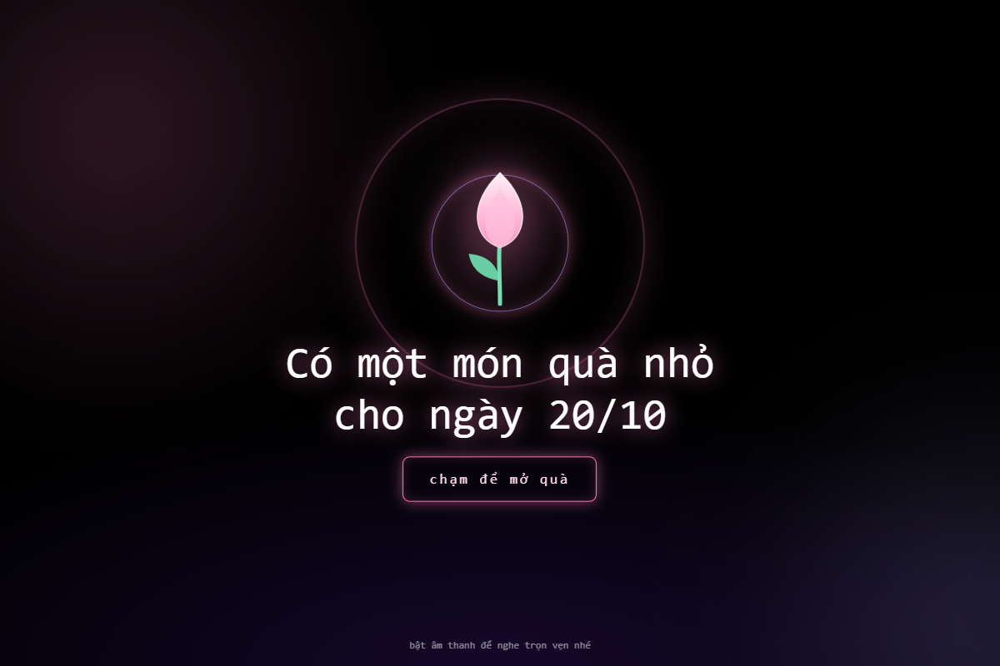
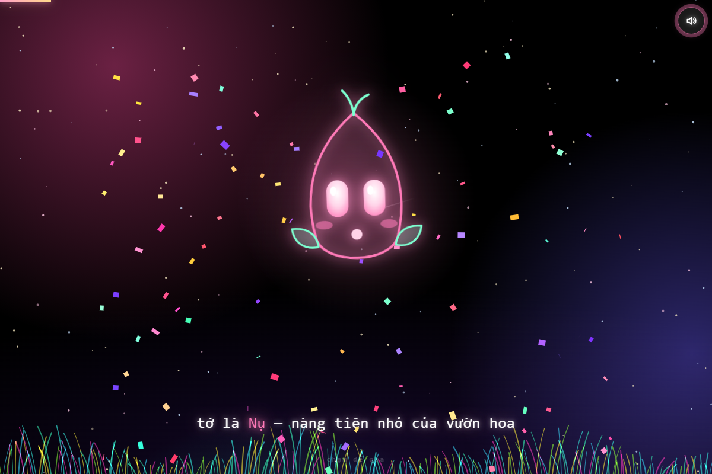
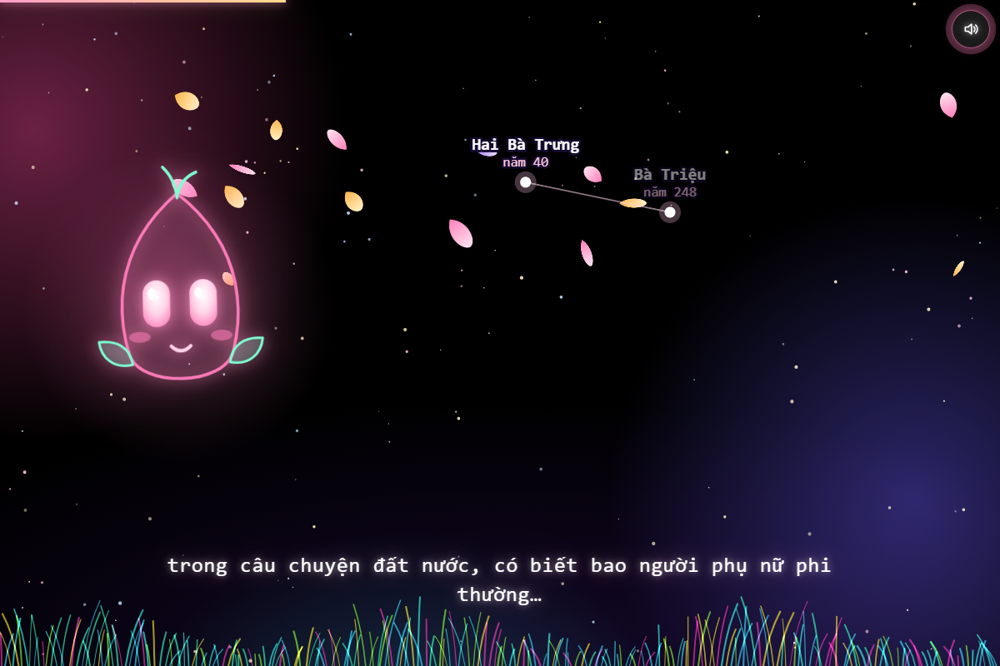

# 🌸 Nụ & Lời Chúc 20/10 - Ngày Phụ Nữ Việt Nam

Dự án web hoạt họa tương tác tri ân và chúc mừng **Ngày Phụ Nữ Việt Nam (20/10)**. Trang web mang phong cách nghệ thuật thơ mộng, kết hợp đồ họa Canvas, SVG chuyển động, hiệu ứng hạt pháo hoa - cánh hoa lung linh và nhạc nền đồng bộ theo nhịp điệu.

---

## 📸 Hình ảnh minh họa (Screenshots)

<div align="center">
  
  <p><em>Màn hình mở đầu tương tác: "Có một món quà nhỏ cho ngày 20/10"</em></p>
</div>

<br>

<div align="center">
  
  <p><em>Nhân vật hoạt hình "Nụ" dẫn dắt lời chúc và cốt truyện</em></p>
</div>

<br>

<div align="center">
  
  <p><em>Hiệu ứng đồ họa sao trời, cánh hoa rơi và câu chuyện tri ân</em></p>
</div>

---

## ✨ Điểm nổi bật & Tính năng chính

- 🎵 **Âm nhạc & Hiệu ứng đồng bộ (Beat Sync):** Nhạc nền trữ tình, lời thoại và hoạt họa chuyển cảnh mượt mà theo nhịp điệu.
- 🎨 **Đồ họa sống động:**
  - Bầu trời sao chuyển động, sao băng và đồng cỏ neon rực rỡ vẽ bằng HTML5 Canvas.
  - Hiệu ứng hạt rơi đa dạng: cánh hoa đào, trái tim bay, đèn lồng, pháo hoa.
  - Nhân vật "Nụ" biểu cảm phong phú (vẫy tay, chớp mắt, ngại ngùng, mỉm cười).
- 📜 **Hành trình ý nghĩa:**
  - Nhắc nhớ cột mốc 20/10/1930 và các nữ anh hùng dân tộc trong lịch sử.
  - Tri ân những điều thầm lặng, bình dị của người phụ nữ xung quanh ta.
  - Gửi gắm 4 lời chúc trọn vẹn: *Sức khỏe*, *Bình yên*, *Tự do* và *Được yêu thương*.
  - Bó hoa kỳ diệu không bao giờ tàn và tương tác hỏi đáp ấm áp.
- 💌 **Tùy biến lời chúc qua URL:** Dễ dàng cá nhân hóa tên người nhận và người gửi để chia sẻ.
- 📱 **Responsive & Tương thích cao:** Hiển thị mượt mà trên cả điện thoại (mobile) và máy tính (desktop).

---

## 📂 Cấu trúc thư mục

```text
20102026-main/
│
├── index.html                  # File web độc lập chính (Single-file HTML: đã nhúng sẵn CSS, JS và Audio)
├── README.md                   # Hướng dẫn và tài liệu dự án
│
├── assets/                     # Hình ảnh chụp màn hình demo
│   ├── preview.png
│   ├── scene.png
│   └── wishes.png
│
├── src/                        # Mã nguồn phân tách module rõ ràng để phát triển & chỉnh sửa
│   ├── index.html              # Giao diện chính
│   ├── style.css               # Toàn bộ CSS phong cách, hiệu ứng ánh sáng
│   ├── script.js               # Logic hoạt họa, xử lý Canvas & kịch bản lời chúc
│   └── music.mp3               # File âm thanh nền
│
└── variants/                   # Các phiên bản thiệp độc lập được tùy biến sẵn
    ├── default/                # Bản chuẩn dự phòng (single-file)
    │   └── index.html
    └── class-10a6/             # Phiên bản lời chúc dành tặng cô Thy & tập thể lớp 10A6
        └── index.html
```

---

## 🚀 Hướng dẫn sử dụng

### 1. Mở trực tiếp
- Mở file `index.html` (ở thư mục gốc) bằng bất kỳ trình duyệt web hiện đại nào (Chrome, Edge, Firefox, Safari,...).
- Nhấp/chạm vào màn hình để mở quà và thưởng thức câu chuyện cùng âm nhạc.

### 2. Tùy biến lời chúc gửi tặng bạn bè, người thân
Bạn có thể gắn thêm tham số vào đường dẫn trang web để hiện tên riêng:

```text
index.html?to=Tên_Người_Nhận&from=Tên_Người_Gửi
```

**Ví dụ:**
- `index.html?to=Mẹ&from=Con trai`
- `index.html?to=Cô giáo&from=Tập thể lớp`
- `index.html?to=Lan Anh`

---

## 🛠️ Công nghệ sử dụng

- **HTML5** & **Semantic Web**
- **CSS3** (CSS Variables, Flexbox, Keyframes Animation, Glow Filters)
- **JavaScript (ES6+)** (Canvas 2D API, Web Audio API, Animation Loop `requestAnimationFrame`)
- **SVG Animation** (Đường vẽ ECG nhịp tim, chòm sao lịch sử, hoa sen, hồ trăng)

---

<div align="center">
  <b>Chúc mừng Ngày Phụ Nữ Việt Nam 20/10! 💐</b>
</div>
